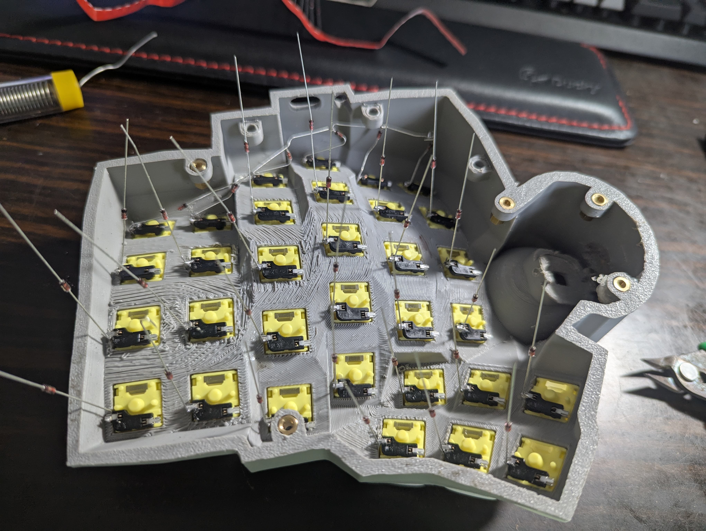
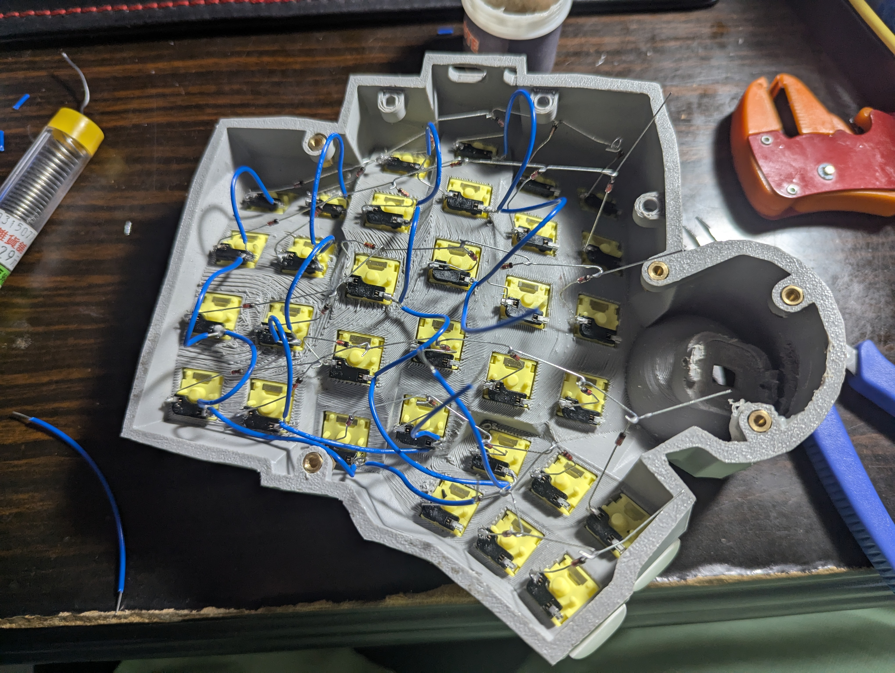
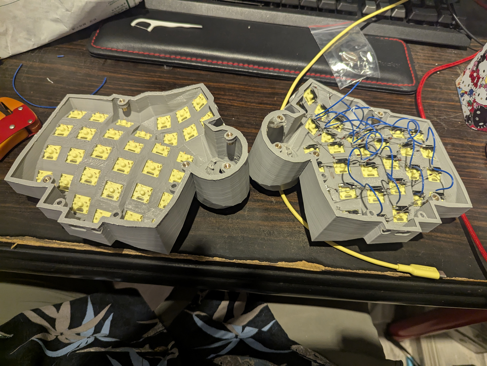
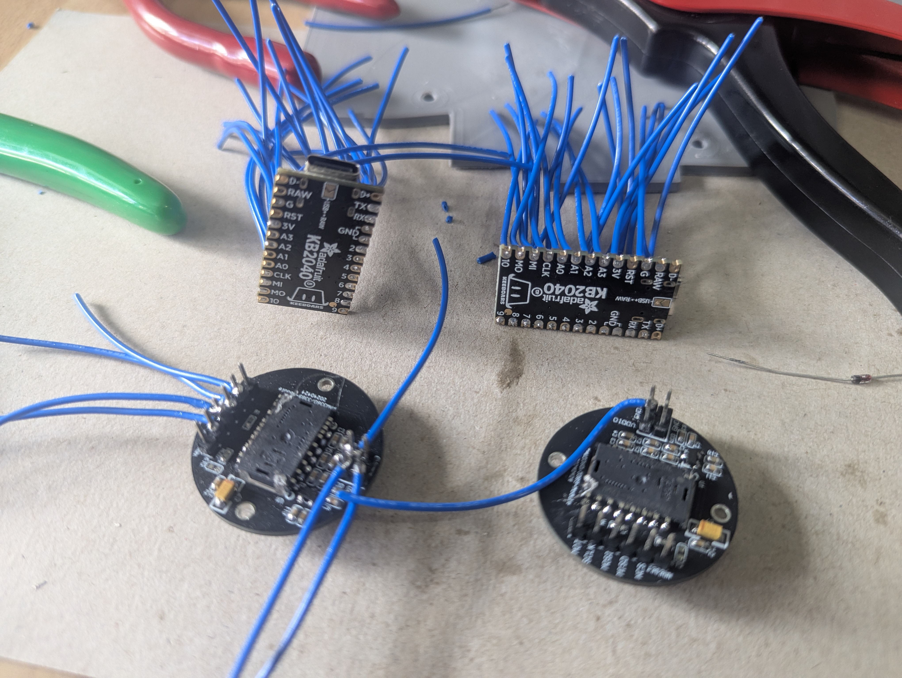
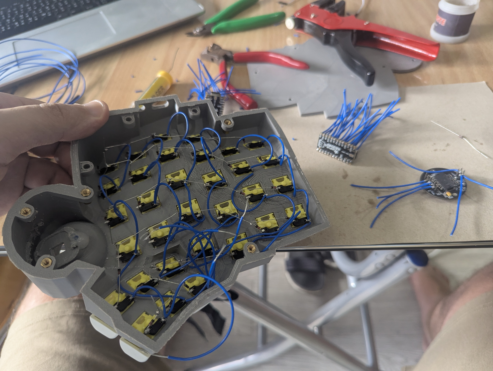
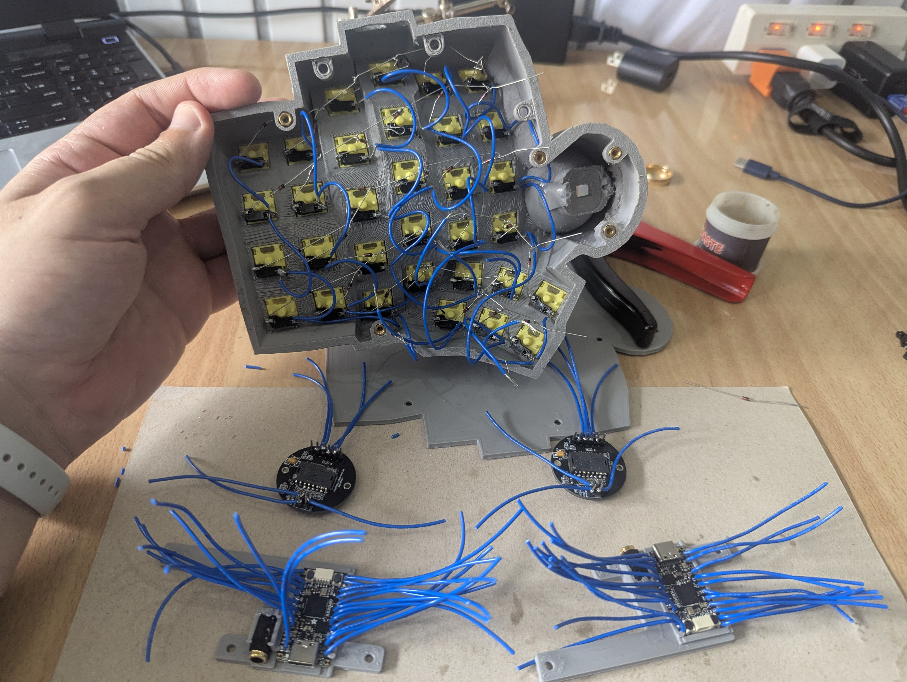
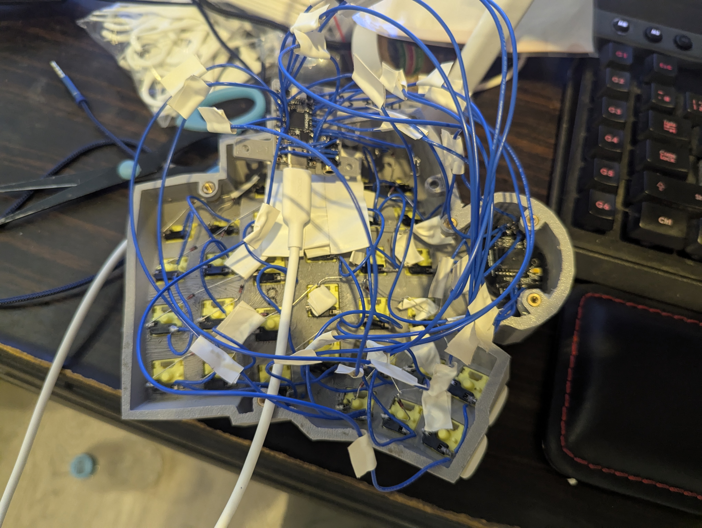
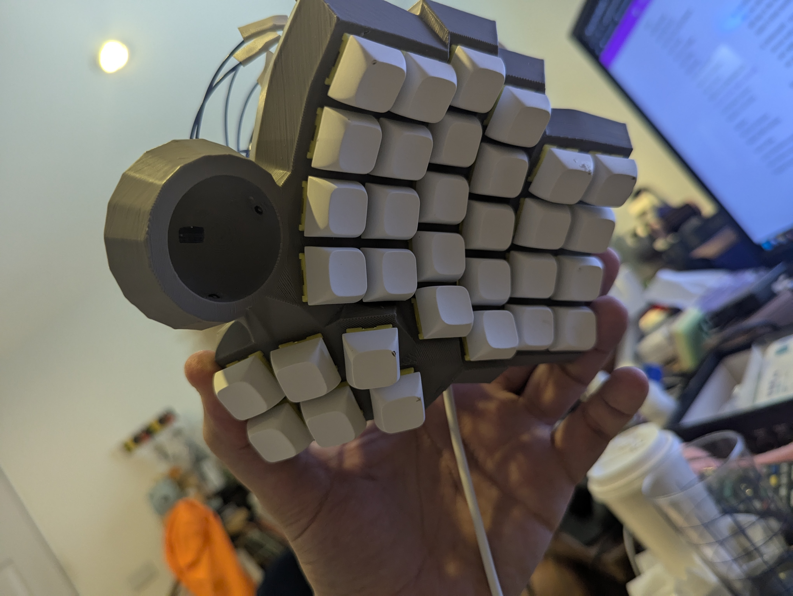

# DuoTractyl

A hand-wired, 3D-printed, split ergonomic keyboard with **a trackball built into each half**.
The right-hand trackball moves the mouse cursor and the left-hand trackball scrolls, so you never have to reach for a mouse.

It runs [QMK firmware](https://qmk.fm) on two Adafruit KB2040 (RP2040) controllers and is remapped live with [VIA](https://usevia.app).

| Left half (scroll ball) | Right half (cursor ball) |
|---|---|
|  |  |

---

## Contents

- [Features](#features)
- [How it works](#how-it-works)
- [Parts list](#parts-list)
- [Choosing the components](#choosing-the-components)
- [The 3D-printed case](#the-3d-printed-case)
- [Hand-wiring](#hand-wiring)
- [Build log](#build-log)
- [Firmware](#firmware)
- [Keyboard layout](#keyboard-layout)
- [Compiling the firmware](#compiling-the-firmware)
- [Flashing the keyboard](#flashing-the-keyboard)
- [Setting up VIA](#setting-up-via)
- [Troubleshooting](#troubleshooting)
- [Version history](#version-history)
- [Repository layout](#repository-layout)

---

## Features

- **Split, column-staggered key wells** with a sculpted thumb cluster on each half, 64 keys in total.
- **Two trackballs, two jobs.** The right ball is the mouse cursor and the left ball is the scroll wheel (vertical and horizontal).
- **Three mouse buttons** (left, middle, right) on the left thumb cluster.
- **Adjustable sensitivity from the keyboard.** Dedicated keys raise and lower cursor speed and scroll speed without reflashing.
- **Smooth cursor movement.** Sub-pixel motion is carried over between reports, so slow, precise movements aren't lost.
- **VIA support**, so keys and layers can be remapped live in the browser.
- **4 layers:** the Night alpha layout, QWERTY, a symbols/numpad/function layer, and a gaming layer.
- **Optional diagnostic logging** to check the link between the halves (see [Troubleshooting](#troubleshooting)).

---

## How it works

```
 ┌──────────── LEFT HALF ────────────┐        ┌──────────── RIGHT HALF ───────────┐
 │                                   │        │                                   │
 │  5×7 key matrix ──► KB2040        │ serial │        KB2040 ◄── 5×7 key matrix  │
 │                     (peripheral)  │◄──────►│   (main / USB)                    │
 │  PMW3360 sensor ──► SPI           │ 460800 │           SPI ◄── PMW3360 sensor  │
 │  (scroll ball)                    │  baud  │                   (cursor ball)   │
 └───────────────────────────────────┘        └──────────────┬────────────────────┘
                                                             │ USB-C
                                                          Computer
```

1. **Each half is its own small computer.** Both halves have a KB2040 microcontroller that scans its own key matrix and reads its own PMW3360 optical sensor over SPI.
2. **The right half is the main half.** It's the half plugged into USB, so QMK makes it the main half (`MASTER_RIGHT` + `SPLIT_USB_DETECT`). The left half is the peripheral.
3. **The halves talk over full-duplex serial.** Up to about 1,800 times a second, the right half asks the left half for its key states and its trackball movement. The link uses the RP2040's PIO hardware on `GP0` (TX) and `GP1` (RX) at 460,800 baud.
4. **The two trackballs are combined into one mouse.** QMK's `POINTING_DEVICE_COMBINED` mode gives the firmware a report from each ball. The keymap code in [`keymap.c`](last%20working%20setup/2.10/build/keymaps/via/keymap.c) then:
   - uses the **right ball** for cursor X/Y, divided by a sensitivity value, with the leftover remainder carried into the next report so no movement is lost.
   - uses the **left ball** for scrolling. It adds up movement in a running tally and sends one scroll step each time the tally passes a threshold. A higher scroll sensitivity means a lower threshold.
   - merges mouse button presses from both halves.
5. **The computer sees one USB device** named *Cosmos DuoTractyl* (VID `0x1209`, PID `0x5070`) that is both a keyboard and a mouse.

---

## Parts list

| Qty | Part | Notes |
|---|---|---|
| 2 | **Adafruit KB2040** | RP2040 microcontroller in a Pro Micro footprint, with USB-C, BOOT and RESET buttons, and a NeoPixel on `GP17`. One per half. |
| 2 | **PMW3360DM-T2QU** optical sensor | High-end mouse sensor, read over SPI. One under each trackball. |
| 2 | **34 mm (1.34 in) trackballs** | Replacement balls for the Logitech MX Ergo / MX Ergo S, which uses a standard 34 mm ball. The left one is blue and the right one is dark grey. Each ball rests directly in a 3D-printed spherical socket, with no bearings. |
| 64 | **Outemu Pear** tactile switches | MX-compatible switches with a tactile bump, so you can feel when a key registers without pressing it all the way down. |
| 64 | **1N4148** diodes | One per key, wired column-to-row (`COL2ROW`), so the keyboard can tell exactly which keys are pressed even when several are held at once. |
| 64 | **White blank XDA keycaps** | Bought from Shopee. XDA is a low, uniform profile: every row has the same shape, which suits a curved key well. Small legend labels were added to the keycaps. |
| 2 | 3.5 mm 4-pin (TRRS) audio jacks | One per half. The 4 pins carry VCC, GND, TX and RX, which is what full-duplex serial needs. |
| 1 | 3.5 mm 4-pin (TRRS) audio cable | Connects the two halves. It must be a 4-pin (TRRS) cable: a 3-pin (TRS) cable doesn't have enough wires. |
| 1 | USB-C cable | Connects the right half's KB2040 to the computer. Also powers the left half through the audio cable. |
| — | Wire | For hand-wiring the matrix and the sensor. |
| — | Filament | For the 3D-printed case (the photos show grey). |

---

## Choosing the components

**Adafruit KB2040 (RP2040).** QMK supports the RP2040 well, and it has plenty of flash (8 MB) and RAM for VIA, two pointing devices and four layers. Its **PIO** hardware gives QMK a fast, reliable full-duplex serial link between the halves on any pins. The KB2040 also has a Pro Micro footprint, a USB-C port, and real **BOOT** and **RESET** buttons, which make flashing easy.

**PMW3360DM-T2QU sensors.** The PMW3360 is a high-end gaming mouse sensor: up to 12,000 CPI, very low noise, and no built-in acceleration. QMK has a ready-made driver for it (`POINTING_DEVICE_DRIVER = pmw3360`). With one sensor per half, each ball can do a different job.

**Two trackballs instead of one.** A single trackball can scroll with a "drag-scroll" layer key, but then you have to hold a key while scrolling. Giving each hand its own ball lets the right hand move the cursor while the left hand scrolls, with no mode switching.

**VIA.** With VIA you can rearrange keys in a browser and the changes apply immediately, with no recompiling. That made it practical to try many layouts (39 saved versions so far) while learning the Night layout.

---

## The 3D-printed case

I designed the case with the **[Cosmos Keyboard Configurator](https://ryanis.cool/cosmos/)**. It's a free, browser-based tool that generates printable models for curved, split keyboards, and it can include trackball mounts. The firmware's manufacturer name, *Cosmos*, comes from it.

The design process:

1. **Shape the key wells.** In Cosmos I set the number of rows and columns, the column stagger, and the curvature, so each finger reaches its keys with little stretching.
2. **Design the thumb cluster.** Each half has a separate, angled thumb cluster.
3. **Add a trackball to each half.** Cosmos can place a trackball mount with room for a sensor underneath. I put one on the inner edge of each half, within reach of the thumb.
4. **Export and print.** I exported the models from Cosmos as STL files and 3D-printed both halves.

### STL files

The printable models are in the [`3d Models`](3d%20Models) folder. Cosmos exports three parts for each half:

| Part | Left | Right | What it is |
|---|---|---|---|
| Case | [`Duotractyl 2-caseleft.stl`](3d%20Models/Duotractyl%202-caseleft.stl) | [`Duotractyl 2-caseright.stl`](3d%20Models/Duotractyl%202-caseright.stl) | The main body: key well, thumb cluster, and trackball socket. |
| Holder | [`Duotractyl 2-holderleft.stl`](3d%20Models/Duotractyl%202-holderleft.stl) | [`Duotractyl 2-holderright.stl`](3d%20Models/Duotractyl%202-holderright.stl) | Holds the KB2040 and the audio jack in place at the back of the case. |
| Plate | [`Duotractyl 2-plateleft.stl`](3d%20Models/Duotractyl%202-plateleft.stl) | [`Duotractyl 2-plateright.stl`](3d%20Models/Duotractyl%202-plateright.stl) | The bottom plate that closes the case. |

The `Duotractyl 2-*` files are the second design revision. The earlier `Duotractyl-*` files (without the "2") are the first revision, kept for reference.

Each 34 mm trackball sits in a **3D-printed spherical socket** on the inner edge of its half. The ball rests directly on the printed surface, with no bearings or ball transfer units, which keeps the build simple. The PMW3360 sensor is mounted underneath the ball, looking up at it through an opening in the bottom of the socket.

---

## Hand-wiring

Each half is wired as a **5-row × 7-column matrix** with one diode per key. The diodes point from column to row (`COL2ROW`). Both halves use the same pins.

### Key matrix

| Matrix | KB2040 pins |
|---|---|
| Rows (5) | `GP2`, `GP3`, `GP4`, `GP5`, `GP6` |
| Columns (7) | `GP7`, `GP8`, `GP9`, `GP26`, `GP27`, `GP28`, `GP29` |

Rows 0–2 use columns 0–5. Rows 3–4 also use column 6 for the inner/thumb keys, which gives 32 keys per half. In the firmware, rows 0–4 are the left half and rows 5–9 are the right half.

### PMW3360 sensor (SPI0)

| Sensor pin | KB2040 pin |
|---|---|
| SCK | `GP18` |
| MOSI | `GP19` |
| MISO | `GP20` |
| CS / NCS | `GP10` |
| VCC / GND | 3.3 V / GND |

SPI0 is turned on in [`mcuconf.h`](last%20working%20setup/2.10/build/mcuconf.h).

### Link between the halves

The halves are joined by a **3.5 mm 4-pin (TRRS) audio cable**, with a matching jack in each half. Each of the jack's 4 pins carries one signal:

| Signal | KB2040 pin |
|---|---|
| TX | `GP0` |
| RX | `GP1` |
| VCC | Power from the right half to the left half |
| GND | Shared ground |

An audio cable connects each pin straight through to the same pin on the other end. Both halves also use the same KB2040 pins. So the crossover has to be in the wiring of one jack: **TX of one half must reach RX of the other.** If you only get key presses from the right half, check this crossover first.

---

## Build log

These photos show the build in order, from May to July 2025. The case is shown from underneath, so the trackball socket looks like it's on the wrong side.

<table>
<tr>
<td width="50%"><a href="PXL_20250528_053931519.jpg"></a></td>
<td width="50%"><a href="PXL_20250528_084043444.jpg"></a></td>
</tr>
<tr>
<td><b>1. Switches and diodes.</b> The switches are pressed into the printed case, and a 1N4148 diode is soldered to each one. The diode legs are left long so they can be bent over and joined to form the row wires.</td>
<td><b>2. Rows and columns.</b> The bare diode legs are joined along each row. Insulated blue wire links each column, so the column wires can cross over the rows without touching them.</td>
</tr>
<tr>
<td><a href="PXL_20250602_132059770.jpg"></a></td>
<td><a href="PXL_20250724_025341112.jpg"></a></td>
</tr>
<tr>
<td><b>3. One half wired, one to go.</b> The right side of the photo shows a fully wired matrix. The other half has its switches in and is ready for diodes.</td>
<td><b>4. Controllers and sensors.</b> Wires soldered to every pin on both KB2040s, and to the two PMW3360 sensor boards.</td>
</tr>
<tr>
<td><a href="PXL_20250724_032421143.jpg"></a></td>
<td><a href="PXL_20250724_041526902.jpg"></a></td>
</tr>
<tr>
<td><b>5. Second half wired.</b> Both matrices are done. The brass heat-set inserts around the edge of the case take the screws that hold the case together.</td>
<td><b>6. Holders fitted.</b> Each KB2040 sits in its 3D-printed holder next to the 3.5 mm audio jack, with the USB-C port facing out of the back of the case.</td>
</tr>
<tr>
<td><a href="PXL_20250725_125013004.jpg"></a></td>
<td><a href="PXL_20250725_125020179.jpg"></a></td>
</tr>
<tr>
<td><b>7. Connecting and testing.</b> The matrix and the sensor are soldered to the KB2040, the wires are taped down, and the half is plugged in over USB to test it before closing the case.</td>
<td><b>8. Keycaps on.</b> A finished half with its XDA keycaps. The empty trackball socket shows the small window that the PMW3360 looks up through.</td>
</tr>
</table>

---

## Firmware

The firmware is a QMK keyboard definition at `keyboards/handwired/duotractyl` inside the [`qmk_firmware`](https://github.com/qmk/qmk_firmware) repository. The latest version is saved in [`last working setup/2.10/build`](last%20working%20setup/2.10/build).

| File | What it does |
|---|---|
| [`keyboard.json`](last%20working%20setup/2.10/build/keyboard.json) | Processor, USB IDs, matrix pins, split settings, and the physical key layout. |
| [`config.h`](last%20working%20setup/2.10/build/config.h) | Split serial settings, trackball sensor settings, handedness, and bootloader settings. |
| [`rules.mk`](last%20working%20setup/2.10/build/rules.mk) | Turns on QMK features: split keyboard, pointing device, mouse keys, NKRO and VIA. |
| [`mcuconf.h`](last%20working%20setup/2.10/build/mcuconf.h) | Turns on the RP2040's SPI0 peripheral for the sensor. |
| [`keymaps/via/keymap.c`](last%20working%20setup/2.10/build/keymaps/via/keymap.c) | Default keymap, the trackball cursor/scroll logic, the sensitivity keys, and the diagnostic logging. |

### Key settings

| Setting | Value | Why |
|---|---|---|
| `SERIAL_USART_SPEED` | `460800` | Fast enough that the link between the halves adds very little lag, and slow enough to be reliable over the cable. |
| `SERIAL_USART_FULL_DUPLEX` | on | TX and RX on separate wires, so data can flow both ways at once. |
| `SPLIT_POINTING_ENABLE` | on | Sends the left trackball's movement to the right half. |
| `POINTING_DEVICE_COMBINED` | on | Lets the keymap handle both trackballs separately (cursor vs. scroll). |
| `POINTING_DEVICE_TASK_THROTTLE_MS` | `1` | Reads the trackballs 1,000 times a second for smooth movement. |
| `PMW33XX_CPI` | `3200` | Sensor resolution before the firmware divides it. |
| `ROTATIONAL_TRANSFORM_ANGLE` | `90` | Rotates the sensor's axes to match how it's mounted in the case. |
| `POINTING_DEVICE_INVERT_X_RIGHT` | on | Flips X on the right ball so the cursor moves the same way as your thumb. |
| `MASTER_RIGHT` | on | The half plugged into USB is the right half. **Always plug USB into the right half.** |
| `RP2040_BOOTLOADER_DOUBLE_TAP_RESET` | on | Double-tap RESET to enter the bootloader. |

### Sensitivity keys

Four custom keycodes change the trackball speed while you use the keyboard. In the current VIA layout they're on layer 2.

| Key | Effect | Range |
|---|---|---|
| `CPICURSORUP` / `CPICURSORDOWN` | Changes the cursor divider: the raw movement is divided by this number. Lower = faster. | 1–10 (default 2) |
| `CPISCROLLUP` / `CPISCROLLDOWN` | Changes scroll sensitivity. Higher = scrolls with less ball movement. | 1–40 (default 2) |

These values reset to the defaults when the keyboard is unplugged.

---

## Keyboard layout

### Choosing the Night layout

The main typing layer uses **Night**, an alternative layout that puts a letter (**R**) on the left thumb so the thumbs do more of the work. These screenshots are from comparing it with other layouts:


### Layers

The current layout is [`duotractyl_via_saved_layout_39.json`](saved%20via%20layouts/duotractyl_via_saved_layout_39.json).

| Layer | Purpose |
|---|---|
| **0 – Night** | Night letters, with **home-row mods**: N/S/H/T and C/A/E/I double as Win/Alt/Ctrl/Shift when held. R is on the left thumb, and the mouse buttons are on the left thumb cluster. |
| **1 – QWERTY** | Standard QWERTY letters, for other people or for games. |
| **2 – Function** | F1–F12, a numpad, arrow keys, the volume keys, the trackball sensitivity keys, and Home/End/PgUp/PgDn. Hold `MO(2)` on either thumb. |
| **3 – Gaming** | WASD-style left-hand layout. The bottom row of the right half has `TO(0)`–`TO(3)` to switch to any layer. |

Early layer designs and the printed keymap reference:

| QWERTY | Night | Function |
|---|---|---|
|  |  |  |


Other keymap images in this folder: [`keymap print.png`](keymap%20print.png), [`keymap image.png`](keymap%20image.png), [`keymap image (1).png`](keymap%20image%20%281%29.png) and [`via keyboard layout 39 printout.png`](via%20keyboard%20layout%2039%20printout.png). [`keymap print layout template.af`](keymap%20print%20layout%20template.af) is the Affinity template used to make the printouts.

---

## Compiling the firmware

These steps are for Windows, using **QMK MSYS**. The `qmk` commands are the same on macOS and Linux.

1. **Install QMK MSYS** from <https://msys.qmk.fm>, then open the *QMK MSYS* terminal.
2. **Set up QMK.** This downloads `qmk_firmware` and installs the ARM compiler:
   ```bash
   qmk setup
   ```
   By default the firmware is downloaded to your home folder, for example `C:\Users\<you>\qmk_firmware`.
3. **Add the keyboard to QMK.** Copy the files from [`last working setup/2.10/build`](last%20working%20setup/2.10/build) into a new folder:
   ```
   qmk_firmware/keyboards/handwired/duotractyl/
   ├── config.h
   ├── keyboard.json
   ├── mcuconf.h
   ├── rules.mk
   └── keymaps/via/keymap.c
   ```
4. **Compile:**
   ```bash
   qmk compile -kb handwired/duotractyl -km via
   ```
   A successful build ends with `Creating UF2 file for deployment` and puts **`handwired_duotractyl_via.uf2`** in the top of the `qmk_firmware` folder. QMK prints some yellow ⚠ warnings about settings that are defined in both `config.h` and `keyboard.json`. They don't affect the build.

If you just want to flash the keyboard, a ready-made `.uf2` is included in each version folder, for example [`last working setup/2.10/handwired_duotractyl_via.uf2`](last%20working%20setup/2.10/handwired_duotractyl_via.uf2).

---

## Flashing the keyboard

The RP2040 has a drag-and-drop bootloader, so you don't need any flashing software. **Flash both halves with the same `.uf2`.** If the halves use different serial settings, they can't talk to each other.

For each half:

1. **Disconnect the cable between the halves**, then plug **only this half** into the computer over USB.
2. **Enter the bootloader** using one of these methods:
   - **Double-tap the KB2040's RESET button**, or
   - hold **BOOT**, tap **RESET**, then let go of BOOT, or
   - press the `QK_BOOT` / `RESET` key, which is on layer 2 in the VIA layout. This only works if the firmware is already running.
3. A USB drive named **`RPI-RP2`** appears. **Copy `handwired_duotractyl_via.uf2` onto it.**
4. The drive disappears by itself and the half restarts with the new firmware.

When both halves are flashed, **connect the cable between the halves first, then plug the right half into the computer.** Plugging the left half into USB makes the halves swap roles (keys mirrored and the cursor and scroll balls switched), because the firmware treats the USB half as the right half.

> Don't plug or unplug the audio cable while the keyboard is connected to the computer. As a TRRS plug slides in or out, its tip briefly touches the other pins in the jack. That can short power to a data pin and damage the controllers.

---

## Setting up VIA

The DuoTractyl isn't in VIA's built-in keyboard list, so VIA needs its definition file once:

1. Open <https://usevia.app> in Chrome or Edge.
2. In **Settings**, turn on **Show Design tab**.
3. In the **Design** tab, load [`pre_via_duotractyl_design_30.json`](upload%20design%20to%20via%20before%20using%20via/pre_via_duotractyl_design_30.json) from the `upload design to via before using via` folder.
4. Go to **Configure** and click **Authorize device**, then choose *Cosmos DuoTractyl*.
5. To restore the current layout, go to **Save + Load → Load** and choose [`duotractyl_via_saved_layout_39.json`](saved%20via%20layouts/duotractyl_via_saved_layout_39.json).

The keymap is stored on the keyboard itself, so it stays the same after reflashing the same firmware and works on any computer.

---

## Troubleshooting

### Diagnostic logging

The firmware has a logging mode for checking the link between the halves. It's off in version 2.10 and on in version 2.9.

1. Set `CONSOLE_ENABLE = yes` in `rules.mk` (and `"console": true` in `keyboard.json`), then compile and flash.
2. View the log with **QMK Toolbox → HID Console**, or in QMK MSYS:
   ```bash
   qmk console -d 1209:5070
   ```

Every 5 seconds the right half prints a status line:

```
[DUO] t=435s side=RIGHT link=OK drops=1 loops/s=1709 maxgap=2ms keysL=19 keysR=20 ballL=637 ballR=739 cursorDiv=2 scrollSens=2
```

| Field | Meaning | Healthy value |
|---|---|---|
| `side` | Which half the USB half thinks it is | `RIGHT` |
| `link` / `drops` | Link to the left half, and how many times it has dropped since power-on | `OK`, and `drops` not going up |
| `loops/s` | How many times per second the main loop runs, including the trip to the left half | about 1,600–1,800 |
| `maxgap` | Longest pause in the main loop | 1–2 ms |
| `keysL` / `keysR` | Key presses from each half (not which keys) | both count up as you type |
| `ballL` / `ballR` | Trackball reports with movement from each half | both count up as you roll |

It also prints `LINK LOST` / `LINK RESTORED after X ms` whenever the left half drops out, and `STALL` whenever the main loop pauses for more than 5 ms.

### Common problems

| Symptom | Likely cause |
|---|---|
| Only the right half works | Cable not plugged in before USB, TX/RX not crossed over, or the halves are running different firmware. Reflash both halves. |
| Keys are mirrored and the trackballs are swapped | USB is plugged into the left half. |
| Cursor or left-hand keys feel laggy | Serial speed set too low or the trackball update interval set too high. Use the values in [Key settings](#key-settings). |
| Link drops randomly (`LINK LOST` in the log) | Hardware: a cold solder joint on a connector, a worn cable, or a loose wire. A slower baud rate only hides it. |
| The cursor jumps the wrong way during fast swipes | The sensor reporting `-128`. The keymap code already treats that value as maximum positive movement. |

---

## Version history

Every working firmware build is saved in [`last working setup`](last%20working%20setup). Each version folder has the QMK files, and most also have the compiled `.uf2` and the matching VIA layout.

| Version | Changes |
|---|---|
| 2.1 | First working split build. Left half was the main half (`EE_HANDS` + `MASTER_LEFT`), 1600 CPI, serial at 460800, debug logging on. |
| 2.2 | Main half moved to the right (`MASTER_RIGHT`). |
| 2.3 | Main half set back to the left. 3200 CPI. Added cursor smoothing (the sub-pixel remainder is carried over). |
| 2.4 | Main half set to the right again, where it has stayed. |
| 2.5 | 1600 CPI test. |
| 2.6 | Back to 3200 CPI. Serial speed lowered to 115200. |
| 2.7–2.8 | Cursor and scroll reports swapped in the code to match the physical balls. X inverted on the right ball only. Debug prints turned off. |
| 2.9 | **Latency fixes:** serial speed back to 460800, trackballs read every 1 ms (was 10 ms), unused layer/mods sync removed, scroll tally overflow fixed, diagnostic logging added. |
| 2.10 | Same as 2.9 with logging turned off. **Current version.** |

---

## Repository layout

```
duotractyl keyboard/
├── README.md                              ← this file
├── 3d Models/                             ← STL files for the case, holder and bottom plate
├── 1 Left.jpg, 2 Right.jpg                ← photos of the finished keyboard
├── PXL_2025*.jpg                          ← build log photos
├── DuoTractyl * layer *.png               ← early layer designs
├── keymap print*.png, keymap image*.png   ← printable keymap references
├── keymap print layout template.af        ← Affinity template for the printouts
├── 2025-07-29 *.png                       ← Night layout research screenshots
├── last working setup/                    ← every working firmware version (2.1 → 2.10)
├── qmk keyboard files backup/             ← early QMK files and VIA layouts
├── saved via layouts/                     ← every saved VIA layout (10 → 39)
├── text files/                            ← text copies of keymaps
├── upload design to via before using via/ ← VIA definition files (load these in VIA's Design tab)
└── whole folder/                          ← full project snapshot
```
